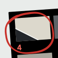

<p align="center"></p>

<h1 align="center">GR4-WebCam</h1>

<p align="center">
  <strong>Control your RICOH GR IV from your phone's browser over Wi-Fi.<br>
  Live view, shutter, exposure settings, and your photos — no app to install.</strong>
</p>

GR4-WebCam is an **opt-in** add-on for the GR IV. When it's switched on, the camera makes its
own Wi-Fi network and serves a web page. Join `GR4-WEB` from your phone, open
`http://192.168.0.1:8080/`, and you can watch live view, change settings, take a shot, and
browse and download your photos, all in the browser. Switch it off and the camera behaves
exactly as it did before.

This repository contains **no RICOH firmware**. You download the official firmware from RICOH
yourself, and the included tool produces your own personalized copy on your computer.

> ⚠️ Installing a modified firmware is at your own risk. A recovery path always exists:
> re-install the official RICOH **GR IV 1.11** firmware. Keep that file on hand before you start.

## What's on the page

The page is built for phones, in portrait or landscape.

- **Live view** in a viewfinder at the top. Tap the corner button for **full screen**, with the
  exposure readout and a shutter laid out like a camera; your phone's back gesture closes it.
- **Camera settings** under the viewfinder, the way the GR shows them on its rear screen:
  exposure mode, shutter speed, aperture, ISO and exposure compensation, then white balance,
  image control, metering, focus, drive and file format. They update while you watch.
- **Change a setting** by tapping it and picking a new value. Values the camera sets itself in
  the current mode (for example shutter and aperture in P) are dimmed; turn the mode dial to
  unlock them.
- **Shutter** with the number of shots left on the card, and a warning when the camera is in
  playback, the card is full, or the camera is running hot.
- **Photos** as a contact sheet, one strip per folder, with frame numbers from the file names.
  Tap a frame to view it with its exposure details, step through with Previous and Next, and
  download the original.
- **Camera details**: battery, storage, capture, location, network and transfer settings.

---

## What you need

- The official RICOH **GR IV 1.11** firmware file (from RICOH's website).
- `squashfs-tools` (`brew install squashfs`) and Python 3 with `numpy`.

## 1. Build your copy

```
python3 firmware/patch_webfw.py --base /path/to/official-firmware.bin --out my-firmware.bin
```

The tool adds only the GR4-WebCam start-up and leaves everything else in the firmware
untouched; it checks this and refuses to write anything if the check fails. (On macOS/Linux
run it with `sudo` so the tool can preserve special files.)

## 2. Prepare the SD card

Copy the three files from `sd/` to the **top level** of the card:

| file | purpose |
| --- | --- |
| `GR4WEB.SH`  | the add-on |
| `GR4WEB.HTM` | the web page |
| `GR4WEB.ON`  | the **on/off switch** — present = on, delete it = off |

## 3. Install & use

1. Install `my-firmware.bin` the normal RICOH way (firmware update from the card).
2. Power the camera on (leave USB unplugged). After ~10–20 s it broadcasts **`GR4-WEB`**
   (password **`gr4camera`**).
3. Join it from your phone and open **`http://192.168.0.1:8080/index.html`**.
   Add it to your home screen to get the GR4-WebCam icon.

## Notes

- **Live view works over Wi-Fi only** — not while a USB cable is connected. Only one device can
  watch at a time.
- **Shutter:** on the page, tap once to ready it and again to shoot, so a stray tap can't fire it.
  In full screen it shoots on one tap.
- **Full screen on iPhone** fills the browser window; Safari doesn't allow true full screen for
  web pages. On Android the page also goes true full screen.
- While a browser is connected, the camera shows it's in a remote state; that clears when you
  disconnect (or automatically a couple of minutes after the last device leaves).
- `GR4-WEB` is a private network with a fixed password and no pairing — it's intended for your
  own use on your own camera.
- **Turn it off** anytime by deleting `GR4WEB.ON` from the card.
- **Recovery:** re-install the official RICOH firmware.

## Layout

```
firmware/patch_webfw.py   builds your copy from the official firmware
sd/GR4WEB.SH              the add-on (goes on the card)
sd/GR4WEB.HTM             the web page (goes on the card)
sd/GR4WEB.ON             the on/off switch (goes on the card)
webui/index.html          the web page (source)
assets/icon.svg           the project icon (also inlined in the web page)
```
